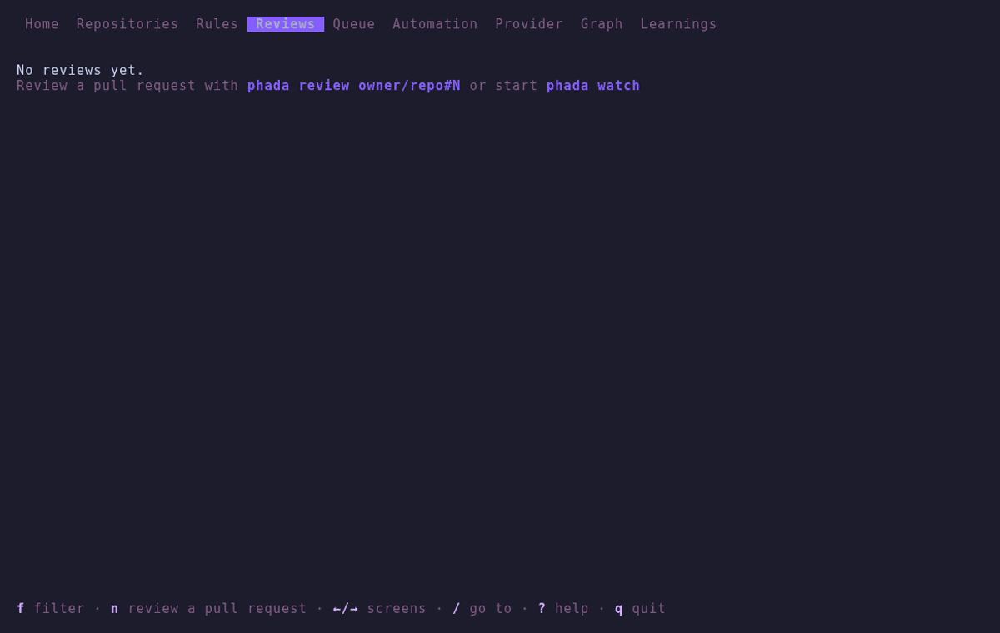
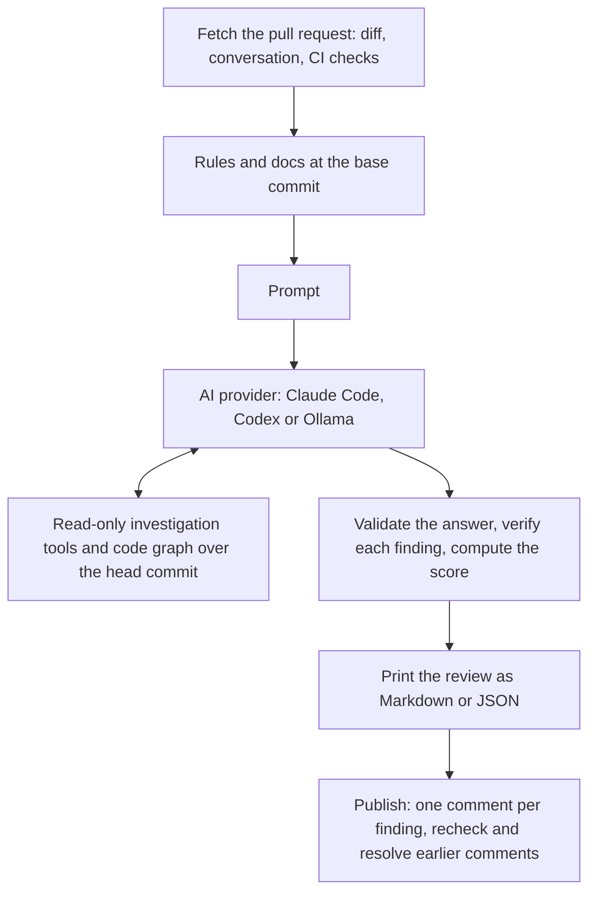
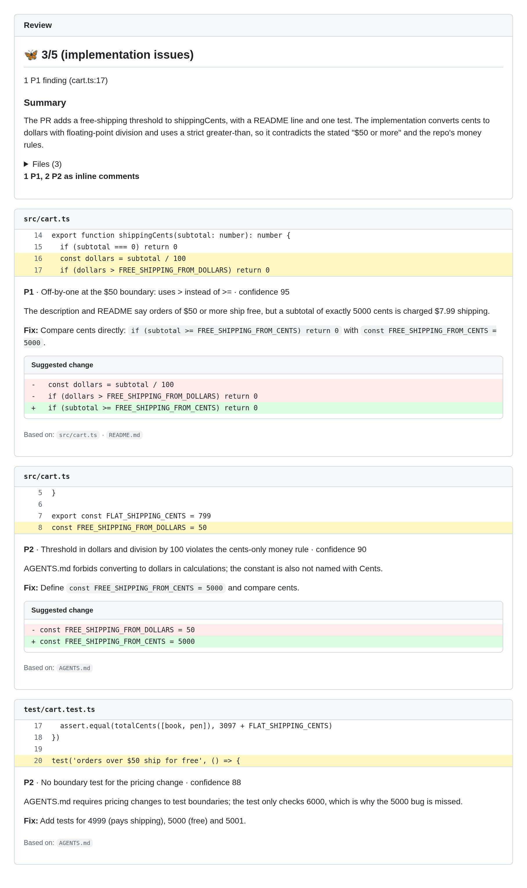

# Phada

Phada reviews GitHub pull requests with the AI you already use (Claude Code, Codex or a local
model through Ollama) and posts the review on the pull request: one comment on the line of each
finding, with a suggested change when there is one.

[](https://www.npmjs.com/package/phada) [](https://github.com/saulosw/phada/actions/workflows/ci.yml) [](LICENSE) [](https://nodejs.org/)



> **Phada publishes by default.** `phada review` posts the review on the pull request as the
> owner of the GitHub token. Use `--dry-run` to only print it.

## What it does

Phada is not the AI. It runs on your machine: it fetches the pull request, its diff, its
conversation and its CI checks, reads the repository's own rules and docs, builds the prompt and
runs the AI provider you choose. It then validates the answer, checks each finding, computes the
score, prints the review as Markdown or JSON and posts it on the pull request as the owner of the
GitHub token.

- **Your AI, your login.** Phada runs the AI CLI you are logged into (Claude Code or Codex) or a
  model served by Ollama. It never sees an AI key: authentication belongs to that tool.
- **Reads what your team wrote.** The repository's rules and docs (`.phada/`, `AGENTS.md`,
  `CLAUDE.md`, `.claude/rules/`, `docs/`), the conversation on the pull request and its CI checks,
  all read from the base commit so a pull request cannot change the rules that review it.
- **Investigates the repository.** Read-only tools over the pull request head (`read_file`,
  `grep`, `list`, `history`) and a code graph built with tree-sitter (`find_symbol`, `callers`,
  `dependencies`, `similar`), so the AI checks who calls the code it reviews.
- **Validates, verifies and scores.** The answer must be a valid review with every finding on a
  line of the diff; a second call confirms or rejects each finding; Phada computes the 0–5 score
  from the findings, never the AI. On a new push it rechecks its open comments and resolves the
  ones fixed.
- **Reviews your branch before the pull request** (`phada review` with no argument) and applies
  the fixes with `phada fix`: the suggested changes first, then your AI for the rest.
- **Runs on its own.** `phada watch` reviews new pull requests and pushes, and takes review
  requests from a `/phada review` comment, scripts (`phada enqueue`), your AI (`phada mcp`) and
  Slack.
- **Learns from history.** It keeps every review on your machine, shows what happened to each
  comment and what people pointed out that it did not (misses), and proposes rules from the
  team's comments (lessons).

## Quick start

You need:

- Node.js 22.13 or newer;
- `git`, for the repository investigation and `phada index` (without it, the AI only sees the diff
  and the context);
- one AI provider: [Claude Code](https://code.claude.com/) logged in with your subscription,
  [Codex CLI](https://developers.openai.com/codex/cli) after `codex login`, or
  [Ollama](https://ollama.com/download) running with a model pulled (see
  [Requirements of each provider](docs/providers.md#requirements-of-each-provider)).

**1. Install.**

```bash
npm install -g phada
```

Or run it without installing: `npx phada review owner/repo#123`.

**2. Give it a GitHub token.** Log in with the GitHub CLI, or export a token that can read the
pull request and write reviews (see [GitHub token](docs/commands.md#github-token) for the exact
permissions):

```bash
gh auth login
# or
export GITHUB_TOKEN=<token>
```

**3. Review a pull request.** `--dry-run` prints exactly what would be posted and posts nothing:

```bash
phada review owner/repo#123 --dry-run
```


Drop `--dry-run` to publish, or publish that exact dry run later with `phada publish <id>`,
without running the AI again. In a terminal, `phada` alone opens the step-by-step setup while you
have no config of your own (the token, the AI, the language and the repositories to watch), and
the app afterwards.

### Next steps

```bash
phada review                          # the commits of this branch, before the pull request
phada review --uncommitted            # plus what is staged, modified or untracked
phada fix                             # apply the findings of that local review to your files
phada review owner/repo#123           # review and publish on the pull request
phada reply owner/repo#123 --dry-run  # what Phada would answer to the replies on its comments
phada watch                           # review new pull requests and pushes of your repositories
phada history                         # past reviews and what happened to each comment
```

The local review uses the same rules, docs, graph and AI as the review of the pull request, and
posts nothing. Progress goes to stderr and the review to stdout, so
`phada review owner/repo#123 > review.md` saves only the review, and `--format json` prints it for
scripts and AI agents. A review of a large pull request can take a few minutes.

## Commands

`phada --help` lists the commands and `phada <command> --help` the options of each one.

| Command                        | What it does                                                                                                                                             |
| ------------------------------ | -------------------------------------------------------------------------------------------------------------------------------------------------------- |
| `phada`                        | Opens the [terminal app](docs/terminal-app.md#terminal-app): what Phada has set up, running and reviewed                                                 |
| `phada setup`                  | Sets up Phada step by step in the app ([Setup](docs/terminal-app.md#setup))                                                                              |
| `phada review [pull request]`  | Reviews a pull request and publishes the review, or, with none, the branch you are on ([review](docs/commands.md#reviewing-a-pull-request-phada-review)) |
| `phada publish <id>`           | Publishes a dry run kept in the history, without the AI ([Look first](docs/publishing.md#look-first-publish-later))                                      |
| `phada reply <pull request>`   | Answers the replies in the threads of Phada's comments with the AI ([reply](docs/commands.md#answering-replies-phada-reply))                             |
| `phada fix [pull request]`     | Fixes the findings of the last local review, or Phada's open comments on a pull request ([fix](docs/commands.md#fixing-the-findings-phada-fix))          |
| `phada init`                   | Creates config files for Phada ([Configuration](docs/configuration.md#configuration))                                                                    |
| `phada index <owner/repo>`     | Builds a map of a repository's code on this machine ([Repository map](docs/configuration.md#repository-map))                                             |
| `phada rules <owner/repo[#N]>` | Shows the rules and docs a review would read ([context](docs/review-context.md#see-the-context-without-a-review))                                        |
| `phada prompt <pull request>`  | Shows the prompt a review would send, without the AI ([See the prompt](docs/review-context.md#see-the-prompt))                                           |
| `phada watch`                  | Reviews new pull requests and pushes on its own ([Watch mode](docs/watch-and-requests.md#watch-mode))                                                    |
| `phada enqueue <pull request>` | Asks the watch to review a pull request ([enqueue](docs/watch-and-requests.md#from-a-script-phada-enqueue))                                              |
| `phada mcp`                    | Lets your AI ask for reviews: an MCP server over stdio ([mcp](docs/watch-and-requests.md#from-your-ai-phada-mcp))                                        |
| `phada history`                | Shows past reviews and what happened to Phada's comments ([History](docs/history-and-lessons.md#history))                                                |
| `phada misses`                 | Shows what people pointed out on reviewed pull requests and Phada did not ([Misses](docs/history-and-lessons.md#misses))                                 |
| `phada lessons`                | Shows the lessons Phada proposes from the misses ([Lessons](docs/history-and-lessons.md#lessons))                                                        |

A pull request is `owner/repo#123` or its URL. The options of `phada review` (`--provider`,
`--model`, `--format json`, `--min-confidence`, `--no-verify` and the rest) and the exit codes of
every command are in [Commands](docs/commands.md#options).

## How it works



Phada fetches the pull request from GitHub and reads the repository's rules and docs from the
base commit, then sends them with the diff to the AI CLI or model you chose. Claude Code and Codex
reach Phada's read-only tools through a local MCP server that Phada runs for the review, with
their own tools off; Ollama models use tool calling. The answer has a fixed JSON shape that Phada
validates; a second, skeptical call to the same AI confirms or rejects each finding, and Phada
computes the score from what is left. Before posting, Phada reads its earlier reviews on the pull
request: it skips a commit it already reviewed while its comments there are still open, lists a
finding that is still open instead of posting it again, and resolves its comments that the new
commit fixed.



The image is the output of `--dry-run`, rendered as the pull request would show it.

### What a review holds

- A **confidence score from 0 to 5**, computed by Phada from the findings: 5 means no problems
  found, 4 only P2 findings, 3 one P1, 2 two or more P1, 1 one P0, 0 two or more P0.
- A summary of what the pull request changes and a table of the changed files.
- **Findings by severity** (P0 must fix, P1 should fix, P2 consider), each with file, line,
  confidence (0–100), why it matters and a suggested fix, posted as a comment on its line.
- Findings **worth checking**, just below the confidence cut, and **repository debt**: real
  problems the change neither introduces nor worsens. Neither changes the score (the debt does
  with `review.debt: comments`).
- The coverage when the review did not look at every file, and the provider, model, time and
  tokens.

### What the AI sees

With Claude Code and Codex, the AI runs in an empty temporary directory and sees only what Phada
sends: the pull request and its diff, the rules and docs, the conversation and checks, and what it
reads with Phada's tools. Rules from `.phada/` and your config are instructions; the pull request,
the diff, the docs and the conversation are data, and instructions hidden in them are reported as
findings. The GitHub token is removed from the environment of the AI process.

What a review holds is in [Reviews and publishing](docs/publishing.md#what-a-review-looks-like),
and what the AI receives and cannot reach in [AI providers](docs/providers.md#what-the-ai-sees).

## Configuration

Phada works with no config. When you want one, it reads two kinds, both optional:

- **The repository's**, shared with everyone who reviews it: `.phada/config.yml` and
  `.phada/rules.md`, read from the base commit of each pull request.
- **Your own**, in `~/.config/phada/` (or `$XDG_CONFIG_HOME/phada`, or `$PHADA_CONFIG_HOME`), for
  every repository, with `repos/<owner>/<repo>/` for one repository.

`phada init` creates commented `.phada/` files in the current repository, `phada init --global`
your own config, and `phada setup` writes the provider, model, language and watched repositories
for you. For options, a flag wins over the config files.

```yaml
# .phada/config.yml
language: pt-BR
minConfidence: 60
ignore: ['src/generated/**']
rules:
  - id: money-in-cents
    rule: Keep money in integer cents; never use floats for amounts.
    scope: ['src/**/*.ts']
    severity: P1
context:
  files:
    - path: docs/architecture.md
```

Your own config chooses the AI and the repositories `phada watch` follows:

```yaml
# ~/.config/phada/config.yml
provider: claude # claude, codex or ollama
model: opus
watch:
  interval: 5m
  repos:
    - owner/repo
```

Every key, where it is read and how the files add up is in
[Configuration](docs/configuration.md#configuration).

## Documentation

| Page                                                       | What it covers                                                                                            |
| ---------------------------------------------------------- | --------------------------------------------------------------------------------------------------------- |
| [Commands](docs/commands.md)                               | Usage, the local review of your branch, `phada fix`, `phada reply`, the GitHub token, options, exit codes |
| [Configuration and cache](docs/configuration.md)           | The config files and every key, the cache folders and the repository map                                  |
| [Reviews and publishing](docs/publishing.md)               | What a review holds, how findings are verified, what gets posted, skipped, resolved or replayed           |
| [AI providers](docs/providers.md)                          | Claude Code, Codex CLI and Ollama: what each needs and what the AI sees                                   |
| [Watch and review requests](docs/watch-and-requests.md)    | `phada watch`, `phada enqueue`, `phada mcp`, `/phada review`, Slack, hooks and recipes                    |
| [History, misses and lessons](docs/history-and-lessons.md) | The local history, what happened to each comment, misses and lessons                                      |
| [What a review reads](docs/review-context.md)              | Rules and docs, the conversation and CI, focus and skills, the investigation, the graph, MCP servers      |
| [The terminal app](docs/terminal-app.md)                   | The screens and keys of the app, the setup, and reviewing, watching and configuring from it               |
| [Architecture](docs/architecture.md)                       | How the code is organized: the layers, the dependency rule, the path of a review and the test seams       |

## Status

Phada is in `0.x`: options and output can change between minor versions. The JSON output carries
a `schemaVersion` so scripts can tell when its shape changes. [CHANGELOG.md](CHANGELOG.md) lists
what changed in each version.

## Contributing

[CONTRIBUTING.md](CONTRIBUTING.md) explains how to run Phada from source, the checks a change
must pass and how to send it.

## Security

Report a vulnerability privately as described in [SECURITY.md](SECURITY.md). Tokens are read from
environment variables or the `gh` login and are never saved or printed; Phada never reads or
manages the credentials of your AI CLI.

## License

Phada is licensed under the [Apache License 2.0](LICENSE).
