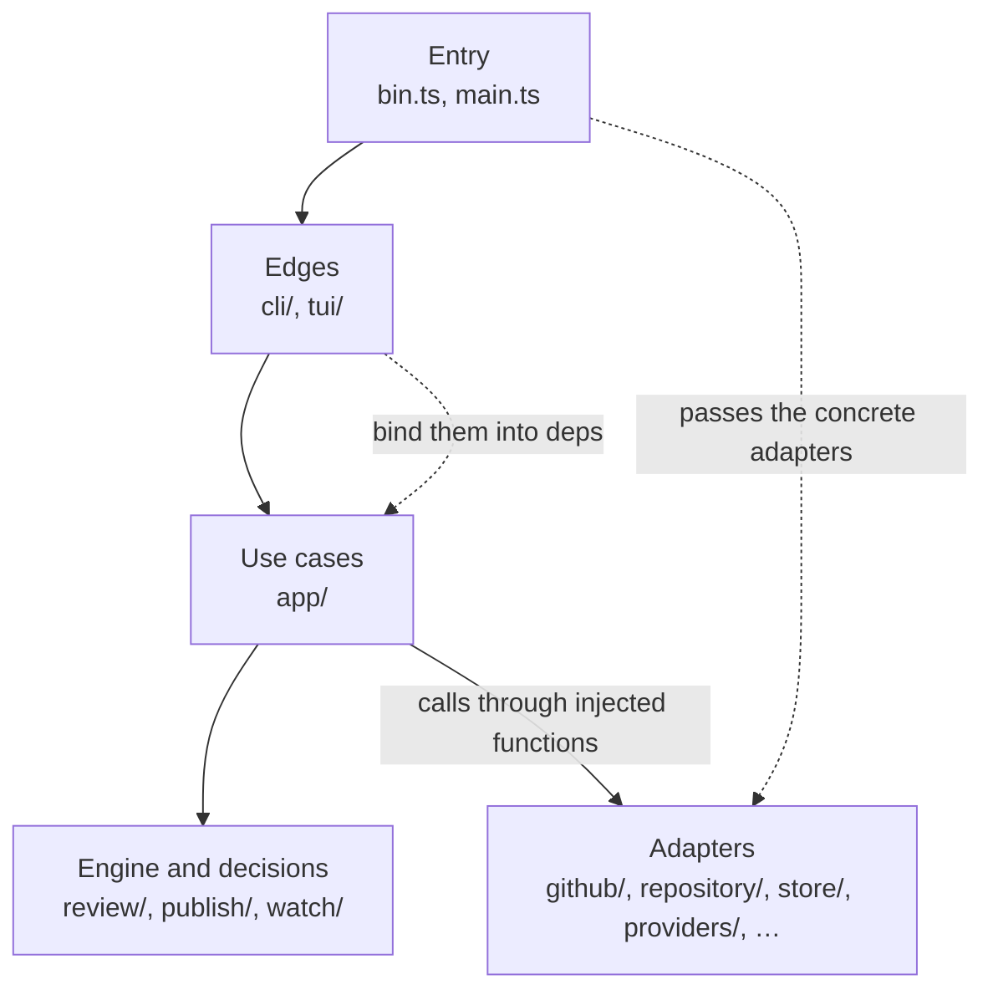
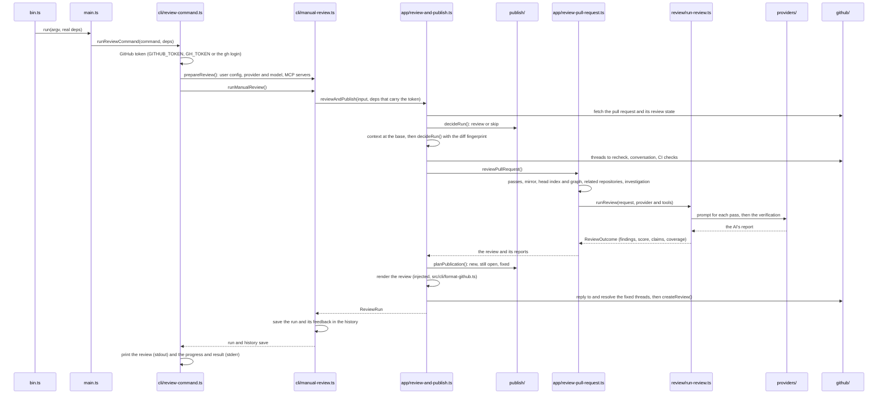

# Architecture

How Phada's code is put together: the layers, the rule between them, the path of one review and
where the tests cut in. The module list is in [layout.md](layout.md); the rules a change must keep
are in [AGENTS.md](../AGENTS.md#dependency-rule).

## The layers

Phada fetches a pull request, builds the prompt, runs an AI provider the developer already uses,
checks and scores the answer, and posts the review. The code is split so that the part that
decides (what to review, what the AI found, what to post) never touches the outside world, and
the part that touches the outside world decides as little as it can.

- **Entry** (`src/bin.ts`, `src/main.ts`): takes the real process and the concrete
  implementations and starts a command.
- **Edges** (`src/cli/`, `src/tui/`): the commands and their output as text or JSON; the terminal
  app.
- **Use cases** (`src/app/`): review and publish, the watch, requests, indexing, fixes, replies and
  the reads the commands and the app share.
- **Pure decisions and the engine** (`src/review/`, `src/publish/`, `src/watch/`): data in, result
  or decision out.
- **Adapters and shared helpers** (`src/github/`, `src/repository/`, `src/store/`,
  `src/providers/`, `src/process/`, `src/graph/`, `src/investigation/`, `src/context/`,
  `src/config/`, `src/skills/`, `src/repo-map/`, `src/gh-facade/`, `src/slack/`): GitHub, git,
  SQLite, the AI CLIs and Ollama, subprocesses, files, tree-sitter and Slack.

A call goes down the list: an edge calls a use case, a use case calls the engine and the pure
decisions, and the adapters reach it as functions and objects it was given.

### Entry: `bin.ts` and `main.ts`

`src/bin.ts` is the only file that hands the real `process` to `run()`. It reads the package
version,
silences Node's warning about the built-in SQLite, and calls `run(argv, deps)` with:

- `process.argv`, `process.env`, the working folder, the home folder, the PID and the three
  standard streams;
- the GitHub functions of `src/github/` (fetch the pull request, its review state, its comments,
  its checks, the repository files; create a review; reply to and resolve threads; list pull
  requests and comments);
- the file system (`nodeFileSystem` of `src/config/local-files.ts`), the openers of the git mirror
  and of the three SQLite files (index, observed relations, history), the tree-sitter extractor
  and the lock of the watch;
- the reader of the `gh` login, the signal handlers (`SIGINT`, `SIGTERM`), an `abort` that kills
  the detached children, removes the open work folders and exits, a `sleep` and a clock;
- `createProvider()`, which `src/main.ts` exports.

`src/main.ts` holds `run()`: it parses the arguments (`src/cli/args.ts`), hands each command to
its module in `src/cli/`, and turns a thrown error into one line and an exit code
(`src/cli/format-error.ts`). `createProvider()` is the one place that builds a concrete provider
(`ClaudeCliProvider`, `CodexCliProvider`, `OllamaProvider`).

### Edges: `cli/` and `tui/`

Each command lives in its own module of `src/cli/` and declares the deps it needs
(`ReviewCommandDeps`, `WatchCommandDeps`, …); `MainDeps` extends them. The command modules and
the wiring modules (`review-wiring.ts`, `manual-review.ts`, `watch-session.ts`, …) turn the raw
deps into the readers, writers and factories a use case takes, closing over the GitHub token, and
print what the use case reports.

The terminal app (`src/tui/`, Ink and React) is the other edge. `src/cli/app-command.ts` builds
its `AppDeps` from the same use cases and loads the app with `import()`, so the other commands
never load React.

### Use cases: `app/`

`src/app/` orchestrates: it calls the engine, the pure decisions and the adapters it was handed,
in order, and reports through events (`ReviewProgress`, `WatchEvent`, …) instead of printing. The
reads (queue, history, rules, repositories, automation, provider, learnings, home) return data,
never text.

### Pure decisions and the engine: `review/`, `publish/`, `watch/`

- `src/review/` is the engine: it takes the pull request with its diff, the context, the options
  and a `ReviewProvider`, runs the passes, parses, verifies, selects and scores the findings, and
  returns a `ReviewOutcome`.
- `src/publish/` decides whether a commit needs a review and which findings become new comments,
  stay in an open thread or count as fixed, from the earlier reviews and threads it is given.
- `src/watch/` decides what the watch does next: which pull requests to queue, which job runs, how
  long to wait for CI, what a failure or a finished run does to a job.

### Adapters

The rest of `src/` reaches the outside world or holds what several layers share: GitHub REST and
GraphQL (`github/`), git through a persistent mirror and the local clone (`repository/`), SQLite
(`store/`), the AI CLIs and Ollama (`providers/`), subprocesses and work folders (`process/`), the
repository graph (`graph/`, `repo-map/`), the read-only tools the AI calls (`investigation/`), the
rules and docs a review reads (`context/`), the config files and folders (`config/`), the skills
of the AI CLIs (`skills/`), the `gh` a native skill runs (`gh-facade/`) and Slack (`slack/`).

## The dependency rule

Inner layers never import outer ones, and the folders that decide import only types from the
folders that act:

- `src/review/`, `src/publish/` and `src/watch/` import, from outside their folder, types and a
  short list of values (`node:crypto` and `zod` in the engine, the byte cut of `src/context/` in
  `src/publish/`, none in `src/watch/`). None of them imports the GitHub client, a store, a
  concrete provider or the CLI.
- `src/context/`, `src/graph/`, `src/skills/` and `src/investigation/` read the repository and the
  disk through readers they are given (the context readers, an `IndexReader`, a
  `LocalFileSystem`, a `Checkout`).
- `src/app/` never imports the CLI, the GitHub client or a concrete provider, and never prints.
- `src/tui/` imports only types of `src/app/` and `src/config/` and the pure helpers it names; it
  never touches `process`, the console or a timer.
- `src/providers/` never imports its callers.

The exact limits of each folder are in [AGENTS.md](../AGENTS.md#dependency-rule).

`src/architecture.test.ts` enforces them. For each checked folder it lists the modules a file may
import as a value and the ones it may import as a type only (`import type`), reads every source
file of the folder, and fails on any other import, static, re-exported or dynamic. It also fails
on the globals a folder may not use: `process` and `console` in most folders, only `console` in
`src/investigation/` and `src/gh-facade/`, the clock and timers (`Date.now`, `setTimeout`) in
`src/watch/`, and timers and the clock in `src/tui/`. Three more checks run on the source:
a provider importing `src/app/`, `src/cli/` or `src/tui/`, a screen of `src/tui/screens/`
importing another screen, and a fixed pause (`setTimeout`, `setInterval`, `settle()`, `sleep()`,
`node:timers`) in the tests of `src/tui/`.

## The path of one review

What happens between `phada review owner/repo#123` and the review on the pull request:

1. `src/bin.ts` passes the real deps to `run()`, which sends the `review` command to
   `runReviewCommand()` in `src/cli/review-command.ts`.
2. The command reads the GitHub token and calls `prepareReview()` (`src/cli/manual-review.ts`): the
   user config layers, the provider and model (flags, then config), and the MCP servers.
3. `runManualReview()` builds the deps of the use case, each GitHub function already bound to the
   token, and calls `reviewAndPublish()` in `src/app/review-and-publish.ts`.
4. `reviewAndPublish()` fetches the pull request and its review state and asks `decideRun()` of
   `src/publish/` whether to review. It loads the context at the base (`src/context/`), asks again
   with the fingerprint of the filtered diff, and reads the threads to recheck, the conversation
   and the CI checks, unless the config turns them off.
5. `reviewPullRequest()` in `src/app/review-pull-request.ts` plans the passes, opens the mirror,
   the index and graph of the head and the related repositories, starts the investigation, creates
   the provider through the factory it was given, and calls `runReview()`.
6. `runReview()` in `src/review/run-review.ts` builds the prompt of each pass, runs the provider,
   parses the report, verifies the candidates, selects and scores the findings, and returns the
   outcome.
7. Back in `reviewAndPublish()`, `planPublication()` of `src/publish/` sorts the findings into new
   comments, findings still open in a thread, and threads found fixed. The renderer the CLI passed
   in turns them into GitHub Markdown. A dry run stops here. Otherwise the fixed threads get a
   reply and are resolved, and `createReview()` of `src/github/create-review.ts` posts one review
   with its line comments.
8. `runManualReview()` saves the run in the history; the command prints the review and the
   progress, which arrived as events while it ran.

## Why the engine and the decisions are pure

`src/review/`, `src/publish/` and `src/watch/` take data and return a result or a decision:

- The engine never sees credentials, files, the environment or GitHub. The pull request, its diff,
  the context and the provider come in as arguments; the provider is an interface. A review can run
  against any provider, from any caller, with nothing to set up.
- `src/publish/` gets the earlier reviews and threads as data and returns what to post. The use
  case does the posting, so the decision is testable without a network and the same in a dry run.
- `src/watch/` never reads the clock: `now` comes in as data. The transitions of a job (queued,
  waiting for CI, done, skipped, superseded, failed, paused) are plain functions, tested one line
  per case.

What these folders can import is small and checked, so a reader of a decision only has to read
the folder.

## One set of use cases for the commands and the app

The commands and the terminal app run the same code in `src/app/`; only the edge differs:

- `phada history` and the Reviews screen read through `readReviews()` and `readReviewDetail()`
  (`src/app/read-history.ts`); `phada watch --status` and the Queue screen through `readQueue()`.
- A review started from the app goes through `prepareReview()` and `runManualReview()`
  (`src/cli/app-review.ts`), as `phada review` does; the watch of the app runs `startWatch()` of
  `src/cli/watch-session.ts`, as `phada watch` does.
- Progress is data. The review reports `ReviewProgress` events; `src/cli/print-review-progress.ts`
  turns them into lines on stderr and `src/tui/review-steps.ts` into the steps on the screen.

Both edges show the same facts because they read the same data.

## Where the tests cut in

- **Injected deps with a real default.** A function that reaches the outside takes it as an
  optional parameter: the GitHub functions and the Ollama provider a `fetch`, the AI CLI providers
  a `command` path and an `env`, the readers a file reader. Tests pass a fake; production uses the
  default. No test mocks a module.
- **The deps of `run()`.** `MainDeps` is everything `src/bin.ts` passes, so the tests of
  `src/main.ts` run a whole command with fake GitHub functions, stores and streams.
- **A fake `fetch`.** `test/support/fake-fetch.ts` answers from queued responses and records every
  call; an unexpected request fails. `test/fixtures/github/` holds trimmed GitHub responses (REST
  and GraphQL) and a sample diff.
- **Fake AI CLIs.** `test/fixtures/bin/` holds `fake-claude`, `fake-codex` and their status
  commands, and `test/fixtures/mcp/` a fake MCP server; the providers run them in place of the real
  binaries.
- **Git.** Tests that need git build temporary repositories (`test/support/git-repo.ts`);
  `test/support/git-isolation.ts`, loaded before every test file, drops the git variables of the
  environment so a test never touches the checkout it runs in.
- **The terminal app.** `test/support/tui.tsx` renders the app with fake deps, a terminal size, a
  scheduler and keys; its tests wait on a condition, never a fixed pause.

`npm test` never touches the network or a real AI CLI. Each test sits next to the module it tests.
